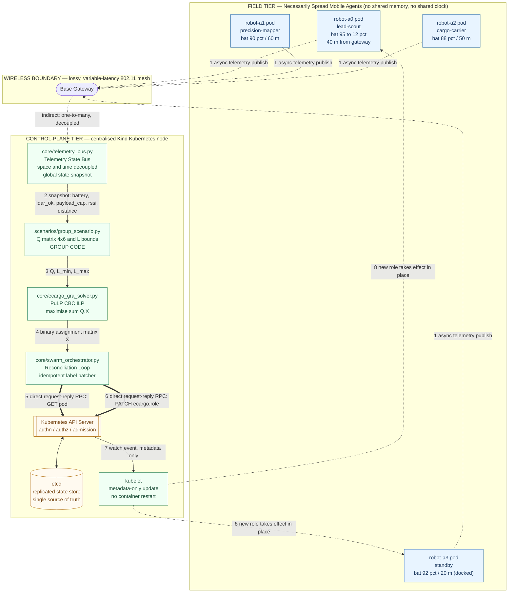
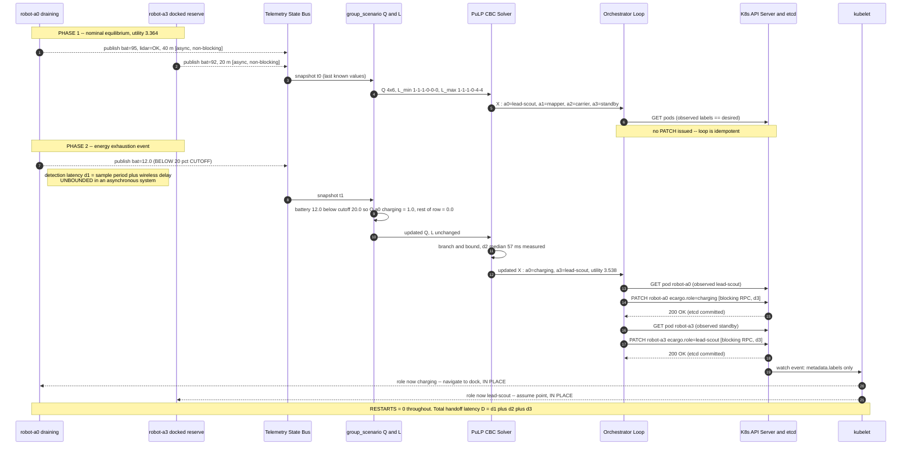
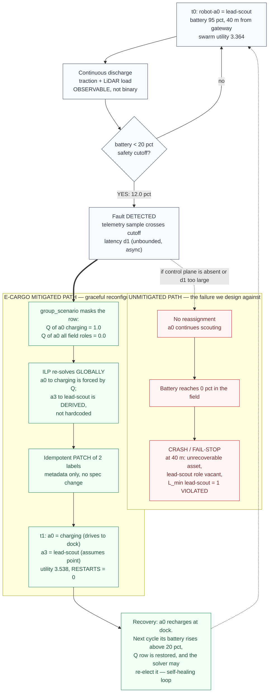
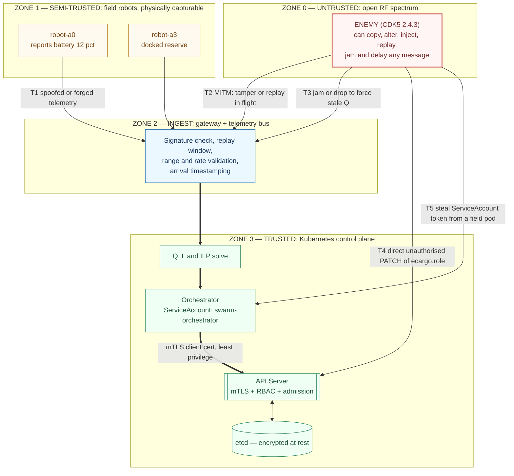

# Unit 3 Architectural & Fundamental System Models (CDK5 Chapter 2)

**Course:** COSC 3657 — Distributed Systems
**Group Members:** Brian Joachim · Alvit Dido · Sadaf Kabir · Jack Coyler
**Assigned Track:** **Track 1 — Critical Energy Evacuation & Handoff**

**Scenario under analysis.** The forward exploration agent `robot-a0` (baseline role
`lead-scout`, operating 40 m from the base gateway) drains its traction battery to
**12.0 %**, below the mission's **20.0 %** safety cutoff. The E-CARGO control plane must
observe this through asynchronous telemetry, re-solve the Group Role Assignment (GRA)
integer program, evacuate `robot-a0` to the `charging` role, and promote the docked
reserve `robot-a3` from `standby` to `lead-scout` — **without restarting a single
container** and **without any agent-to-role pair being hardcoded**.

| Phase | `robot-a0` | `robot-a1` | `robot-a2` | `robot-a3` |
| :--- | :--- | :--- | :--- | :--- |
| **1 — Nominal** | `lead-scout` | `precision-mapper` | `cargo-carrier` | `standby` |
| **2 — Energy event** | **`charging`** | `precision-mapper` | `cargo-carrier` | **`lead-scout`** |

---

## 1. Architectural Model (CDK5 Section 2.3)

CDK5 §2.3 decomposes an architectural model into three questions: *what are the
communicating entities*, *what communication paradigms do they use*, and *how are
entities placed and mapped onto the physical infrastructure*. Each is answered below for
our swarm control plane.

### 1.1 System Architecture Diagram



**Legend.** Dotted edges (`-.->`) are **indirect, asynchronous** flows across the
wireless boundary — the sender does not block and does not know the identity of the
eventual consumer. Thick solid edges (`==>`) are **direct, synchronous request-reply
RPCs** to a named endpoint. Thin solid edges are in-process function calls inside the
orchestrator (negligible latency, no failure semantics of their own).

### 1.2 Communicating Entities (CDK5 §2.3.1)

CDK5 distinguishes the *system-oriented* view (processes, nodes) from the
*problem-oriented* view (objects, components, services). Both are listed, because
E-CARGO roles are a problem-oriented abstraction layered over system-oriented pods.

| # | Entity | System-oriented view | Problem-oriented / E-CARGO view | Responsibility in Track 1 |
| :--- | :--- | :--- | :--- | :--- |
| 1 | `robot-a0` … `robot-a3` | 4 pods, each one container, on the Kind node | **Agents** `a0..a3` in E-CARGO; each carries exactly one **Role** via the `ecargo.role` label | Publish hardware telemetry; execute whatever role their label currently names. `robot-a0` is the degrading agent; `robot-a3` is the docked reserve that absorbs the handoff |
| 2 | `core/telemetry_bus.py` | Aggregator process holding the state snapshot | The **Environment** *E* of the E-CARGO tuple | Collects the five metrics per agent plus the external job-queue depth; produces one *consistent global state snapshot* per cycle |
| 3 | `scenarios/group_scenario.py` | Group-authored evaluation module | Constructs the **Qualification matrix** *Q* (4×6) and role cardinality vectors *L*<sub>min</sub>, *L*<sub>max</sub> | Translates `battery = 12.0 < 20.0` into `Q[a0, charging] = 1.0` and `Q[a0, j≠charging] = 0.0`; leaves all other agents' rows driven purely by their own telemetry |
| 4 | `core/ecargo_gra_solver.py` | PuLP front-end to the CBC branch-and-bound solver | The **Group Role Assignment** operator | Solves `max Σ Q[i,j]·X[i,j]` s.t. one role per agent and `L_min[j] ≤ Σ_i X[i,j] ≤ L_max[j]`; returns binary **X** |
| 5 | `core/swarm_orchestrator.py` | Reconciliation-loop client process | Adaptive **middleware** (CDK5 §1.5.5, §2.3.2) | Compares desired role (from **X**) with observed label; issues a `PATCH` only on divergence (idempotence) |
| 6 | Kubernetes API Server | Server process, the single authority | **Group** membership registry / naming service | Authenticates, authorises (RBAC) and admits every mutation; serialises concurrent writers via resource versions |
| 7 | `etcd` | Replicated key-value store (Raft) | Durable **Object** store for role state | Persists `ecargo.role`; makes the assignment survive orchestrator crashes |
| 8 | `kubelet` | Node agent | Local actuator | Receives the watch event and applies the label **in place**; because only `metadata.labels` changed, no container is recreated — `RESTARTS` stays `0` |

### 1.3 Communication Paradigms (CDK5 §2.3.2)

The system deliberately uses **two different paradigms on the two halves of the loop**,
because the two halves have opposite requirements.

| Property | **Upstream: telemetry ingestion** | **Downstream: role actuation** |
| :--- | :--- | :--- |
| Paradigm | **Indirect communication** — publish-subscribe / shared state over a third party (CDK5 §6.1, Ch. 6) | **Direct request-reply RPC** over HTTPS (CDK5 §5.2, §5.3) |
| **Space uncoupling** | **Yes** — a robot publishes `battery = 12.0` without knowing the solver, the scenario module, or how many consumers exist. `robot-a0` can be replaced by `robot-a7` with no change to any consumer | **No** — the orchestrator must name the exact resource: `PATCH /api/v1/namespaces/default/pods/robot-a0` |
| **Time uncoupling** | **Yes** — the publisher does not block and need not be reachable when its value is consumed; the last known value survives the sender going dark | **No** — the orchestrator blocks on the HTTP response and must handle the error synchronously |
| Delivery semantics | At-most-once, best-effort, stale-tolerant | Request-reply with retries; made safe by **idempotence** (writing a label is a `PUT`-like set, not an increment) |
| Why chosen | A battery reading from a robot that is about to brown out must not be able to block the control loop. Decoupling means a late or lost sample degrades *freshness*, not *liveness* | A role change is a **state mutation that must be confirmed**. We need the API server's authn/authz/admission verdict and a durable `etcd` write before believing the handoff happened |
| Failure visibility | Silent — absence of a sample is indistinguishable from a slow sample (see §2.2) | Explicit — `403`, `409`, `404`, timeout all surface at the call site |

The asymmetry is the architectural heart of the design: **sense indirectly and
optimistically, actuate directly and confirmably.**

### 1.4 Placement, Mapping and Reconfiguration Transparency (CDK5 §2.3.3, §1.5.7)

```text
 LOGICAL TIER            PHYSICAL PLACEMENT (this demo)       PLACEMENT IN A REAL FLEET
 ─────────────────────── ──────────────────────────────────── ───────────────────────────────
 Field agents a0..a3     4 pods on the single Kind node,      4 physically separate robots,
 (sensing + actuation)   simulating necessarily spread        each its own CPU/clock/battery,
                         mobile nodes                         own failure domain
 ─ ─ ─ ─ ─ ─ ─ ─ ─ ─ ─ ─ ─ ─ ─ ─ wireless boundary ─ ─ ─ ─ ─ ─ ─ ─ ─ ─ ─ ─ ─ ─ ─ ─ ─ ─ ─ ─
 Telemetry state bus     in-process module (run_demo.py)      MQTT / Kafka broker at the edge
 Q + L evaluation        in-process module                    same broker host or edge server
 GRA ILP solver          in-process CBC on the dev host       control-plane pod (CPU-bound)
 Orchestrator            in-process K8s client                Deployment with its own SA
 ─────────────────────── ──────────────────────────────────── ───────────────────────────────
 API server + etcd       Kind control-plane container         3-or-5-node HA quorum
```

Four placement decisions and their justification (CDK5 §2.3.3 — *mapping of services to
multiple servers, caching, mobile code, mobile agents*):

1. **Centralised decision, distributed execution.** The ILP is solved in exactly one
   place. GRA is a *global* optimisation: the fitness of promoting `robot-a3` to
   `lead-scout` cannot be evaluated by `robot-a3` alone, because the role is capacity
   constrained (`L_max[lead-scout] = 1`). Distributing the decision would require
   consensus on every cycle; centralising it trades a single point of failure (mitigated
   by `etcd` durability + orchestrator restartability) for a provably optimal assignment.
2. **The telemetry snapshot is a cache.** It holds the *last known* value per agent, so
   the solver always has a complete 4×6 matrix even when a sample is late. The cost is
   staleness, analysed in §2.1.
3. **Role state lives in `etcd`, not in the orchestrator.** The orchestrator is
   stateless between cycles; it re-reads each pod's current label before patching. Kill
   it mid-demo and the next run reconciles from observed cluster state rather than from
   lost memory.
4. **Metadata-label patching gives reconfiguration transparency.** This is the key
   mechanism, and it is what distinguishes Unit 3 from Unit 2:

   * A pod's **`spec`** (image, command, resources) is largely immutable; changing it
     forces the container to be recreated — a **crash-stop** event with loss of
     in-memory state and a bump in `RESTARTS`.
   * A pod's **`metadata.labels`** are mutable at any time. `PATCH`ing
     `ecargo.role: lead-scout → charging` rewrites one string in `etcd`; the kubelet sees
     a metadata-only diff and applies it in place. The container's PID 1 is never
     signalled.
   * Consequently the swarm is **reconfigured while it is running**. `robot-a3`'s
     navigation stack keeps its accumulated map while its *role* — and therefore the work
     it selects, the topics it subscribes to, and the `Service`/`NetworkPolicy`
     selectors that match it — changes underneath it. The role is late-bound data, not
     baked-in code, which is precisely CDK5's **reconfiguration / mobility transparency**
     (§1.5.7, §21).
   * Verified in the demo by `RESTARTS = 0` and unchanged `AGE` across Phase 2.

---

## 2. Fundamental Models (CDK5 Section 2.4)

### 2.1 Interaction Model (CDK5 §2.4.1)

#### 2.1.1 Sequence & Timing Diagram



#### 2.1.2 Synchronous vs. Asynchronous Assumptions

CDK5 §2.4.1 defines a **synchronous** distributed system as one with known bounds on
(i) message delivery delay, (ii) each process's execution step time, and (iii) clock
drift rate. An **asynchronous** system has no such bounds. Our system is a **hybrid**,
and the boundary falls exactly on the wireless link:

| Segment | Model | Justification | Bound |
| :--- | :--- | :--- | :--- |
| Robot → telemetry bus | **Asynchronous** | 802.11 mesh with mobile endpoints: retransmissions, interference, and multipath make delay unbounded in principle. `robot-a0` at 40 m with a dying battery may also be transmitting at reduced power | None assumed |
| Q/L evaluation | Effectively synchronous | Pure arithmetic over a 4×6 matrix, no I/O | < 1 ms |
| ILP solve | Bounded in practice, exponential in theory | Branch-and-bound on 24 binaries with 4 + 12 constraints; the search space is trivially small | **Measured on the demo host (15 runs): min 44 ms, median 57 ms, worst 1262 ms.** The spread is *not* search effort — PuLP invokes CBC as a child process via temporary LP files, so the cost is dominated by process spawn and disk I/O, and the worst case is an OS scheduling outlier. This is the loop's compute budget |
| Orchestrator → API server | **Synchronous in practice** | Loopback HTTPS to the Kind container, with client timeouts and TCP retransmission | **Measured (10 runs each): `GET pod` median 7.1 ms (worst 81.6 ms); `PATCH pod` median 12.6 ms (worst 25.1 ms).** `PATCH` costs roughly 2× a `GET` because it must pass admission and commit to `etcd`. Up to 8 calls per cycle (4 `GET` + up to 4 `PATCH`) ⇒ **d₃ ≈ 60–80 ms** for a two-pod handoff |
| API server → kubelet | Asynchronous watch | Push notification over a long-lived stream; no delivery deadline | None assumed |

**Why the hybrid matters for Track 1.** Correctness of the *decision* never depends on
timing: the ILP is a pure function of the snapshot it is handed, so a late sample yields
an assignment that is optimal for a stale world, never an invalid one. Timing instead
bounds **safety margin**. The 20 % cutoff is not the battery level at which `robot-a0`
becomes unable to move; it is a budget that must cover the whole unbounded chain
`D = d₁ + d₂ + d₃` *plus* the physical drive time from 40 m back to the dock. A design
rule follows directly:

> `E_cutoff ≥ E_drive(d_max) + E_idle(D_worst) + E_reserve`

The 8 % gap between the 20 % cutoff and `robot-a0`'s 12 % observed level is the slack
that absorbs detection latency. If the mesh degrades and `d₁` grows, the *cutoff must be
raised*, not the code changed — the threshold is the tunable that converts an
asynchronous-system assumption into a physical guarantee.

#### 2.1.3 Clock Skew, Telemetry Freshness and Event Ordering

The four agents have no shared physical clock (CDK5 §2.4.1: *no global clock*), and each
drifts at its own rate — worse on battery-starved hardware, where thermal conditions and
power saving affect the oscillator. Three concrete consequences:

1. **Staleness is invisible without timestamps.** The provided `AgentTelemetry` dataclass
   carries no `timestamp` field, so the bus cannot distinguish "`robot-a0` is healthy at
   95 %" from "`robot-a0`'s last successful transmission said 95 % and it has since gone
   dark". Under drift, a sender-stamped field would not fix this either: a robot whose
   clock is 4 s fast appears *fresher* than it is. **Mitigation:** stamp on arrival at the
   gateway (a single reference clock, so skew cancels), carry a monotonic sequence number
   per agent to detect gaps and reordering, and treat `now − arrival > TTL` as a failed
   sample rather than a valid one (see §2.2).
2. **The snapshot is not a true global state.** The bus assembles rows sampled at
   *different* real instants and hands them to the solver as one matrix. The assignment
   is therefore optimal for a world that may never have existed simultaneously. This is
   acceptable because our metrics are **slowly varying relative to the loop period** —
   battery discharge is on the order of %/minute, while the loop closes in well under a
   second. It would *not* be acceptable for a metric that changes faster than the loop,
   which is the standard argument for consistent cuts / vector clocks (CDK5 §14.5) if the
   model were extended.
3. **Ordering of the handoff is enforced by the API server, not by clocks.** The two
   `PATCH`es (`a0 → charging`, `a3 → lead-scout`) are causally related: both are consequences
   of one solve, and `L_max[lead-scout] = 1` means they must not both hold `lead-scout`.
   We never rely on wall-clock ordering. The API server serialises writes and
   `resourceVersion` detects conflicting concurrent updates, so a second orchestrator
   replica cannot interleave a stale assignment. There is nonetheless a brief window in
   which the fleet has **zero** `lead-scout`s (after `a0`'s patch, before `a3`'s) — a
   *transient constraint violation in the physical world* even though the computed **X**
   satisfies `L_min` exactly. Patching the promotion before the demotion inverts the
   window to a transient *double* assignment. Which window is safer is a mission-policy
   choice; for an energy evacuation, promoting first is preferable, since a brief overlap
   of scouts costs less than a brief absence of one.

---

### 2.2 Failure Model (CDK5 §2.4.2)

#### 2.2.1 Failure Taxonomy Applied to Track 1

CDK5 §2.4.2 classifies faults as **omission** (process crash / message loss),
**arbitrary (Byzantine)**, or **timing**. Track 1's event does not fit the classic
crash-stop box, and that is the point of the exercise:

| CDK5 class | Where it appears in this system | Track 1 relevance |
| :--- | :--- | :--- |
| **Process omission — crash** | Pod deleted / container killed; Unit 2's reactive model | **Not our fault mode.** `robot-a0` never crashes; it stays `Running` and responsive |
| **Process omission — fail-stop** (crash *detectable* by others) | What energy exhaustion *becomes* if the control plane does nothing: the robot browns out 40 m from base and is unrecoverable | **The outcome we preempt** |
| **Communication omission** | Dropped telemetry samples over the mesh | Secondary risk: hides the degradation (Track 3's primary mode) |
| **Timing failure** | Telemetry older than the control-loop period; solver exceeding its budget | Erodes the safety margin computed in §2.1.2 |
| **Arbitrary / Byzantine** | A compromised agent reporting false metrics | Deferred to the security model, §2.3 |
| **Partial / graceful degradation** (resource exhaustion) | **Battery 95 % → 12 %: the agent is alive, honest, and progressively less capable** | **Our primary fault mode** |

Resource exhaustion is a *continuous, observable, predictable* degradation, not a binary
up/down transition. That is what makes a **preemptive** response possible: the fault is
visible while the agent can still act on the instruction to withdraw. The system
converts an impending fail-stop into a planned, graceful role transition.

#### 2.2.2 Fault-Propagation and Recovery Diagram



#### 2.2.3 Crash-Stop (Unit 2) vs. Graceful Role Reconfiguration (Unit 3)

| Dimension | **Unit 2 — reactive crash-stop recovery** | **Unit 3 — preemptive E-CARGO reconfiguration** |
| :--- | :--- | :--- |
| Trigger | Pod already `Failed`/deleted — the fault has **happened** | Telemetry crosses a threshold — the fault is **predicted** |
| Fault class | Process omission (crash-stop) | Partial degradation / resource exhaustion |
| Detection | Liveness/readiness probe timeout; absence of heartbeat | Presence of a *truthful, continuous* metric from a live agent |
| Response | Recreate an **identical, stateless, interchangeable** replica | Reassign **roles among heterogeneous, non-interchangeable** agents |
| Node assumption | Homogeneous replicas, shared image, fungible | Heterogeneous hardware: `payload_cap` 0.50–0.95, position 20–60 m, independent batteries |
| Mechanism | Delete + recreate pod → container restart, in-memory state lost | `PATCH metadata.labels` → **in-place**, `RESTARTS = 0`, state preserved |
| Downtime | Image pull + init + warm-up (seconds to minutes) | One API round trip (milliseconds) |
| Physical consequence | A dead robot in the field is **not** recreated by a controller — the asset is lost | The asset drives itself home and rejoins the fleet after recharge |
| State after recovery | Fresh replica, no history | Same processes, new role; accumulated map/odometry intact |
| Optimality | None — any scheduler-chosen node will do | Provably optimal: `max Σ Q·X` subject to `L` |
| Failure of the recovery mechanism itself | Controller down ⇒ no replacement pod | Orchestrator down ⇒ labels simply stop changing; the fleet holds its **last valid, `etcd`-durable** assignment (fail-safe, not fail-open) |

**The core argument.** Unit 2's model is sound only because replicas are *identical*: any
pod can replace any other, so recovery is replacement. A robot swarm breaks that
assumption at the hardware level — `robot-a3` cannot become `robot-a0`, and `robot-a0`'s
battery cannot be recreated by the scheduler. Recovery therefore has to be
**reassignment of responsibility rather than replacement of a process**, and it has to
happen *before* the fault completes, while the degrading agent is still able to comply.
E-CARGO supplies exactly that: `Q` encodes *who is currently capable of what*, `L`
encodes *what the mission structurally requires*, and the ILP finds the best feasible
mapping between them on every cycle.

#### 2.2.4 Residual Failure Modes (honest limitations)

1. **Single-point decision failure.** The ILP runs in one process. Mitigation: it is
   stateless and restartable, desired state is derivable from `etcd`, and the fallback
   behaviour is to hold the last assignment. A leader-elected `Deployment` with
   `replicas: 2` would remove the availability gap; `resourceVersion` conflict detection
   already makes concurrent writers safe.
2. **Silent telemetry omission is indistinguishable from health.** If `robot-a0` stops
   transmitting at 25 %, the cached snapshot keeps it eligible for `lead-scout` forever —
   a **fail-open** hole. Mitigation: a TTL on each row, with expiry treated as a fault
   (`Q[i, :] = 0` except `standby`/`charging`), i.e. *absence of evidence must become
   evidence of absence*.
3. **Infeasibility is a hard stop.** With `L_min[lead-scout] = 1` and `L_max = 1`, a
   second simultaneous battery failure still solves, but a fleet in which every agent is
   below cutoff makes the ILP infeasible and `solve_gra` raises. Mitigation: relax `L_min`
   under a declared degraded-mission mode rather than failing the loop.
4. **No verification of actuation.** A successful `PATCH` proves the *label* changed, not
   that the robot physically drove to the dock. A production system closes that loop with
   an acknowledgement field in telemetry (`role_acked`) and alerts on divergence.

---

### 2.3 Security Model (CDK5 §2.4.3)

CDK5 §2.4.3 builds the security model by identifying the **objects to protect**, the
**threats** against processes and channels, and an **enemy** able to copy, alter, inject
and replay messages. Our protected objects are the *telemetry channel* (because it
determines `Q`) and the *role labels* (because they determine behaviour).

#### 2.3.1 Trust Boundaries and Attack Surface



**Boundary rule.** Zones 0–1 are outside our control: a field robot can be captured,
opened and re-flashed, so its *software identity* must be revocable and its *claims*
must never be trusted implicitly. Zone 2 is the choke point where every claim is
authenticated and sanity-checked. Only inside Zone 3 is data treated as fact. The
one-way flow `0 → 1 → 2 → 3` with validation at the Zone 2 edge is the whole security
architecture in one sentence.

#### 2.3.2 Threat Analysis and Mitigations

| ID | Threat (CDK5 class) | Attack on Track 1 | Impact | Concrete mitigation |
| :--- | :--- | :--- | :--- | :--- |
| **T1** | **Telemetry spoofing** — falsified `Q[i,j]` (arbitrary/Byzantine process failure) | **(a) Masquerade as `robot-a0` reporting `battery = 12.0`** when it is actually at 95 %: triggers a needless evacuation, strips the fleet of its best scout (`Q = 0.982`) and wastes a dock cycle. **(b) The inverse — the captured `robot-a0` under-reports drain and reports `95.0`** while truly at 8 %: the cutoff never fires and the robot fail-stops in the field. **(c) Inflate `payload_cap` to 1.0** to capture the `cargo-carrier` role | Direct control of the optimisation input ⇒ attacker-chosen **X**. This is the highest-severity threat because the ILP faithfully optimises whatever it is told | **Per-agent cryptographic signing**: each robot holds a unique private key (ideally in a TPM/secure element so capture does not yield a cloneable key); the bus verifies an Ed25519 signature over `(agent_id, metrics, seq, nonce)` and drops unverifiable rows. **Plausibility filters** at Zone 2: reject out-of-range values, and reject physically impossible deltas — battery cannot rise while undocked, and cannot fall 83 points in one period. **Cross-validation**: a dock-side sensor independently confirms a `charging` agent actually arrived, so T1(a) is detected within one cycle |
| **T2** | **MITM tampering / replay** on the wireless link (channel threat) | Intercept `robot-a3`'s frames and replay an old `battery = 15 %` sample so `a3` looks ineligible for promotion; the evacuation then has no healthy successor | `L_min[lead-scout] = 1` can only be met by a worse agent, or the ILP is driven toward infeasibility | **TLS/DTLS on the robot↔gateway link** for confidentiality + integrity; signatures (T1) prevent forgery, and a **monotonic sequence number + nonce with a bounded acceptance window** defeats replay of an otherwise valid signed payload |
| **T3** | **Jamming / selective drop** (communication omission, DoS) | Jam only `robot-a0`'s uplink after it passes 20 %. The bus keeps serving the last good sample (95 %), the cutoff never fires, and the robot strands itself — an availability attack that needs no cryptographic break | Defeats the entire preemptive design while every signature still verifies | **Freshness as a security property, not just a quality one**: TTL per row, `Q[i, field roles] = 0` on expiry, so a silenced agent is treated as failed. Alert on sample-rate anomalies; require a positive heartbeat rather than inferring health from the last value |
| **T4** | **Unauthorised `PATCH` of `ecargo.role`** (unauthorised invocation) | Anyone who can reach the API server with sufficient rights relabels `robot-a0` back to `lead-scout`, overriding the evacuation — or mass-relabels the fleet to `standby`, halting the mission | Total loss of control-plane integrity; the orchestrator's decisions are silently overridden | **mTLS + RBAC least privilege.** Anonymous and unauthenticated access disabled; the orchestrator runs as a dedicated `ServiceAccount` whose `Role` grants only `get`/`list`/`watch`/`patch` on `pods` in `default` — **no `create`, `delete`, `exec`, or `secrets`** (see §2.3.3). A **`ValidatingAdmissionPolicy`** additionally rejects any `ecargo.role` write whose value is not one of the six legal roles and whose requester is not the orchestrator SA, so even a credential leak cannot write a nonsense role |
| **T5** | **Credential theft / privilege escalation** | Compromise a field pod and read its mounted SA token, then reuse it as the orchestrator | Converts a Zone-1 compromise into a Zone-3 compromise | `automountServiceAccountToken: false` on all `robot-*` pods (they never call the API); short-lived **bound** projected tokens for the orchestrator; `NetworkPolicy` denying egress to the API server from the swarm namespace's agent pods; audit-log alerting on any `patch pods` by a subject other than the orchestrator SA |
| **T6** | **Denial of service against the decision loop** | Flood the bus with high-rate forged rows, or craft inputs that lengthen the branch-and-bound search | Loop period grows past the energy safety margin of §2.1.2 — a timing failure induced deliberately | Per-agent rate limiting and bounded queue depth at Zone 2; a hard **solver timeout** with the previous assignment retained on expiry (fail-safe); API-server request throttling |
| **T7** | **Confidentiality of mission state** | Passive eavesdropping reveals fleet positions (20–60 m), battery levels and role structure — targeting intelligence even with no write access | Operational exposure; no integrity loss | Encrypt telemetry in transit (T2); **`etcd` encryption at rest** for label/metadata state; restrict `get pods` RBAC so role topology is not readable fleet-wide by unprivileged subjects |

#### 2.3.3 Least-Privilege RBAC for the Orchestrator

The orchestrator needs exactly two verbs on exactly one resource. Granting more would
make T4/T5 catastrophic rather than contained:

```yaml
apiVersion: v1
kind: ServiceAccount
metadata:
  name: swarm-orchestrator
  namespace: default
---
apiVersion: rbac.authorization.k8s.io/v1
kind: Role                      # namespaced, NOT ClusterRole
metadata:
  name: ecargo-role-patcher
  namespace: default
rules:
  - apiGroups: [""]
    resources: ["pods"]         # pods only; no secrets, no configmaps, no exec
    verbs: ["get", "list", "watch", "patch"]
    # deliberately absent: create, update, delete, deletecollection
---
apiVersion: rbac.authorization.k8s.io/v1
kind: RoleBinding
metadata:
  name: swarm-orchestrator-binding
  namespace: default
subjects:
  - kind: ServiceAccount
    name: swarm-orchestrator
    namespace: default
roleRef:
  kind: Role
  name: ecargo-role-patcher
  apiGroup: rbac.authorization.k8s.io
```

Note the security benefit of the *architectural* choice in §1.4: because reconfiguration
needs only `patch` on `metadata.labels`, the control plane never requires `delete` on
pods. A Unit-2-style crash-stop recovery model would have needed pod `delete` rights —
i.e. the power to destroy the fleet — to do its job. **Choosing label patching over pod
recreation shrinks the blast radius of a stolen credential from "delete every robot" to
"mislabel a robot, reverted on the next reconciliation cycle."** Safety and security
align here rather than trading off.

---

## 3. Appendix A — Numerical Derivation of the Track 1 Handoff

The transitions are **emergent**, not programmed. `inject_scenario_event()` mutates one
hardware metric (`telemetry["robot-a0"].battery = 12.0`); everything else follows from
`compute_q_and_bounds()` and the ILP.

**Role index order:** `0 lead-scout · 1 precision-mapper · 2 cargo-carrier · 3 signal-relay · 4 charging · 5 standby`

### A.1 Phase 1 — Nominal baseline

`pending_jobs = 1` ⇒ `required_carriers = min(2, max(1, ⌈1/2⌉)) = 1`;
`min(rssi) = −70 > −85` ⇒ `relay_needed = 0`.
`L_min = [1,1,1,0,0,0]`, `L_max = [1,1,1,0,4,4]`.

| Agent | lead-scout | precision-mapper | cargo-carrier | signal-relay | charging | standby |
| :--- | ---: | ---: | ---: | ---: | ---: | ---: |
| `robot-a0` | **0.982** | 0.874 | 0.475 | 0.050 | 0.050 | 0.380 |
| `robot-a1` | 0.935 | **0.828** | 0.765 | 0.050 | 0.050 | 0.360 |
| `robot-a2` | 0.916 | 0.810 | **0.836** | 0.050 | 0.050 | 0.352 |
| `robot-a3` | 0.874 | 0.677 | 0.736 | 0.050 | 0.050 | **0.718** |

Optimal **X** (bold cells): `a0 → lead-scout`, `a1 → precision-mapper`,
`a2 → cargo-carrier`, `a3 → standby`. **Utility = 0.982 + 0.828 + 0.836 + 0.718 = 3.364.**

This equilibrium reproduces the labels declared in `manifests/swarm_fleet.yaml`, so
Phase 1 issues **no `PATCH` calls at all** — direct evidence that the reconciliation loop
is idempotent. Note that `a0` wins `lead-scout` on merit (0.982, the matrix maximum: 95 %
battery, healthy LiDAR, and the `+0.08` forward-position bonus for being ≥ 40 m out),
while `a3` takes `standby` because its 20 m dock proximity earns a `+0.35` bonus that
outweighs its field-role scores.

### A.2 Phase 2 — Energy exhaustion

`battery[a0] = 12.0 < 20.0` ⇒ the cutoff branch in `compute_q_and_bounds()` sets
`Q[a0, charging] = 1.0` and leaves the rest of row `a0` at `0.0`. No other row changes;
`L_min`/`L_max` are unchanged (an energy event does not alter the cargo backlog).

| Agent | lead-scout | precision-mapper | cargo-carrier | signal-relay | charging | standby |
| :--- | ---: | ---: | ---: | ---: | ---: | ---: |
| `robot-a0` | 0.000 | 0.000 | 0.000 | 0.000 | **1.000** | 0.000 |
| `robot-a1` | 0.935 | **0.828** | 0.765 | 0.050 | 0.050 | 0.360 |
| `robot-a2` | 0.916 | 0.810 | **0.836** | 0.050 | 0.050 | 0.352 |
| `robot-a3` | **0.874** | 0.677 | 0.736 | 0.050 | 0.050 | 0.718 |

**Why `robot-a3` and not `robot-a1`?** With `a0` removed from contention, `a1` has the
highest raw `lead-scout` score (0.935) — a greedy per-role heuristic would promote `a1`.
The ILP rejects that, because `L_min[precision-mapper] = L_min[cargo-carrier] = 1` must
still be satisfied by someone:

| Candidate assignment of `{a1, a2, a3}` to the three field roles | Utility (+1.000 for `a0 → charging`) |
| :--- | ---: |
| `a3`→scout, `a1`→mapper, `a2`→carrier | 0.874 + 0.828 + 0.836 = **2.538** → **3.538** ✅ |
| `a1`→scout, `a2`→mapper, `a3`→carrier | 0.935 + 0.810 + 0.736 = 2.481 → 3.481 |
| `a2`→scout, `a1`→mapper, `a3`→carrier | 0.916 + 0.828 + 0.736 = 2.480 → 3.480 |
| `a1`→scout, `a3`→mapper, `a2`→carrier | 0.935 + 0.677 + 0.836 = 2.448 → 3.448 |
| `a2`→scout, `a3`→mapper, `a1`→carrier | 0.916 + 0.677 + 0.765 = 2.358 → 3.358 |

Promoting `a1` gains 0.061 on `lead-scout` but forfeits 0.118 elsewhere, because `a1` is
the fleet's second-best mapper *and* a strong carrier while `a3`'s off-dock scores are
weak (its 20 m position costs it the mapper range factor, `0.80`). The solver therefore
promotes the **reserve** rather than cannibalising a productive agent — the global
optimum, and exactly the behaviour a human operator would want. **Utility rises
3.364 → 3.538**, since the forced `charging` assignment scores 1.000.

**Verified transitions:** `robot-a0: lead-scout → charging`,
`robot-a3: standby → lead-scout`, with `robot-a1` and `robot-a2` untouched — matching the
Track 1 specification in `README.md`, and confirming that the energy evacuation and the
successor election are two halves of **one** optimisation, not two scripted steps.

---

## 4. Appendix B — Live Cluster Verification

Environment: Kind cluster `cosc3657-unit3`, 4 pods from `manifests/swarm_fleet.yaml`,
`python run_demo.py` executed against the live API server.

See `docs/demo_evidence.md` for the captured terminal transcript and the
`kubectl get pods -l app=ecargo-swarm -L ecargo.role` output taken **before** and
**after** Phase 2, showing the expected label transitions with `RESTARTS = 0` and
unchanged pod `AGE` — the empirical proof of reconfiguration transparency argued in §1.4.
